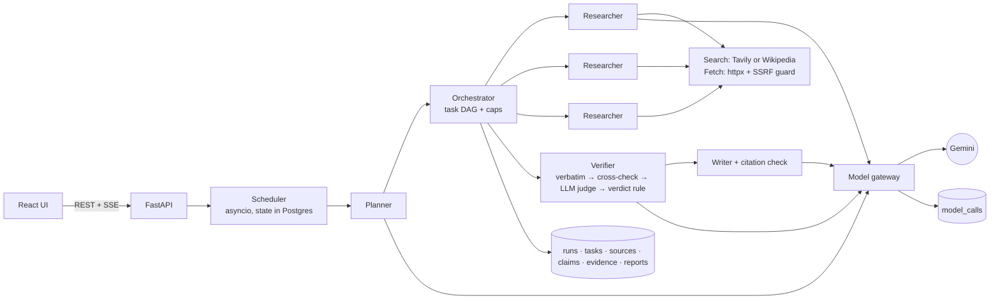

# Deep Research Agent

**Ask a hard question. A planner splits it into sub-questions you can edit, parallel researcher agents
search and read the web, a verifier checks every claim against the exact quotes behind it, and a writer
produces a report in which every sentence links to its evidence.**

For anyone who needs a cited answer they can audit, not a confident paragraph. Build 04 of the
"AI Engineer Projects Roadmap": planning, agent orchestration, source verification.

- **Live link:** https://deep-research-agent-plum.vercel.app (API: https://deep-research-agent-api.onrender.com/api/health). Starting a run needs a demo access code, so the free model quota is not open to everyone; ask me for it. The free Render instance sleeps when idle, so the first request can take about a minute. Setup in [DEPLOYMENT.md](DEPLOYMENT.md).
- **Demo video:** not recorded yet.
- **Headline numbers (live, Tavily search, all 22 labelled questions):**
  - **54.5%** of cited claims are "supported": verbatim quotes from 2+ independent sites, with no strong contradiction.
  - **100%** of cited claims are backed by at least one verbatim supporting quote.
  - 21 of 22 answers are correct.
  - About **$0.001** and a p50 of **14 s** per report, using about 5 model calls each.
  - See [Evaluation](#evaluation).
- **Live demo capacity:** the demo runs on a shared free-tier Gemini key, with its own models capped at 15 calls each and 30 a day in total. One report is capped at 10 calls and uses about 5, so the live demo can produce **about 5 quick reports a day** (at least 3). After that, new runs get a clear "resets at 00:00 UTC" message. See [DEPLOYMENT.md](DEPLOYMENT.md#quota-plan-for-the-live-demo).

## What it does

1. **Ask** a question with a depth (quick, standard or deep), a token budget and a number of parallel researchers.
2. **Review the plan.** The planner returns JSON (a brief plus sub-questions with `depends_on`). You can
   edit, add or remove sub-questions and rewire dependencies; cycles are rejected. Nothing is searched until you approve.
3. **Watch it work.** Server-sent events stream each search, page read, claim extracted and claim checked. Independent sub-questions run at the same time.
4. **Read the report.** Every sentence carries numbered claim chips coloured by verdict. Disputed claims appear in their own section. Single-source claims are hedged.
5. **Audit a claim.** Each quote is shown with its stance (supports, contradicts or not enough) and confidence, highlighted in the stored page text, with the source's domain, publish and fetch dates, and content hash.

## Architecture



| Layer | Choice |
|---|---|
| API | FastAPI, Pydantic v2, SSE progress tailing a `run_events` table |
| Orchestration | plain asyncio: a DAG of tasks with caps on workers, steps, attempts, tokens and wall time; resumes after a crash |
| Model | Gemini (`gemini-3.5-flash-lite`, falling back to `gemini-3.1-flash-lite`) through one gateway that logs every call |
| Search / fetch | Tavily when `TAVILY_API_KEY` is set, otherwise the Wikipedia REST API; `httpx` plus a readability-style extractor |
| Data | PostgreSQL 16, SQLAlchemy 2, Alembic |
| UI | React 19, Vite, TypeScript, Tailwind v4, TanStack Query, React Router |

The verdict rule (a design choice, as in the roadmap): **supported** = verbatim quotes from 2 or more
independent origins and no strong contradiction; **disputed** = a strong contradiction; otherwise
**unverified**. Sources that share a domain, a content hash or a near-duplicate fingerprint count as one
origin, so ten copies of one press release count once.

Full walkthrough with file paths: [WORKFLOW.md](WORKFLOW.md). Design questions answered from the code: [INTERVIEW_QUESTIONS.md](INTERVIEW_QUESTIONS.md).

## Evaluation

Rule from the roadmap: no eval, not done. Mocked tests and live-model runs are kept strictly apart below.

### Live: real Gemini plus real search

All live runs were on 2026-10-31 at quick depth (the planner made 1–2 sub-questions, with 2 sources each) and
3 workers. Raw records, including every quote, verdict and model call, are in `evaluation/runs/<name>/`, and
scores are in `evaluation/results/<name>.json`. A question without a report counts as wrong, with zero recall.

| Metric | Wikipedia search<br/>gemini-3.5-flash-lite<br/>n=10 | **Tavily search**<br/>gemini-3.5-flash-lite<br/>**n=22 (full set)** |
|---|---|---|
| Answer accuracy (accepted answer string in the report) | 9 / 10 | **21 / 22** |
| Required-fact recall (mean) | 0.85 | **0.955** |
| Cited claims with a verbatim quote judged "supports" | 87.5% (14/16) | **100%** (44/44) |
| Cited claims rated **supported** (2+ independent sites) | 0% (0/16) | **54.5%** (24/44) |
| Researcher quotes found verbatim in the stored page | 100% | 98.5% |
| Independent sites per report (median) | 1 | 3 |
| Model calls per report (mean, retries included) | 4.9 | 5.0 |
| Tokens per report (mean) | 6,487 | 6,567 |
| Cost per report (mean) | $0.0008 | **$0.00095** |
| Wall time per report | p50 10.5 s, max 32.1 s | **p50 13.9 s**, max 47.8 s |

Result sets: `live-wiki-quick` (Wikipedia, n=10) and `live-tavily-22` (Tavily, n=22). The Tavily set combines six questions run first with sixteen run later, all scored with cross-check v2. For the first six, verdicts come from the re-verified copy and cost and time from the original single pass.

**The most important change, measured on identical research:** cross-check v2 (`verifier.py: best_sentence`).

- *The problem:* the cross-check looks in other stored pages for a sentence that confirms or contradicts a claim. It needed 60% word overlap, so it missed real sites wording a fact differently ("architectural height … 828 meters (2,717 feet)" vs "828 m (2,717 ft) tall").
- *v2:* it also accepts a sentence that repeats one of the claim's numbers and shares at least 30% of its words, with units and digit grouping normalised.
- *How it was measured:* `evaluation/reverify.py` re-ran **only the verifier** on the first six stored Tavily runs, so the pages, claims and report were identical.

| | Cross-check v1 | Cross-check v2 |
|---|---|---|
| Cited claims rated "supported" | 33% (5/15) | **47%** (7/15) |
| Cited claims with a verbatim supporting quote | 93% (14/15) | 100% (15/15) |

4 claims moved up and none moved down. I read all of them by hand, and a random sample of 5 "supported" claims from the later batch: each is backed by real quotes from 2–3 independent sites.

**Production models (`live-tavily-prod-models`, n=2):** the deployed config uses `gemini-3.1-flash-lite-preview` so the three demos never share a model's quota. Both questions were answered correctly, and 40% of cited claims were supported. It is slower: p50 31 s per report and 5–12 s per call, and one plan call hung 88 s before a 5xx. Hence the 30 s production timeout and the fall-back to the second model.

**Failures and limits these runs exposed:**

- **q15 (no report):** Tavily returned generic "Treaty" pages, and the researcher correctly extracted no claims. The run used to end as "completed" with an empty report. It now fails visibly with `no_claims`.
- **Copied text across sites:** in q06 two sites carry the identical sentence about the Nile ("most major sources still call the Nile the world's longest river") and counted as two origins. Copy detection works per page, and only that sentence was copied. A sentence-level fingerprint would catch it.
- **Source quality isn't judged:** "independent" means different sites, not reliable ones. An instagram.com page counted as an origin in q12.
- **Rate limits:** per-minute 429s hit 4 runs. The gateway retried them all successfully, at the cost of 15–30 s of backoff.
- **Small samples:** answer checks are deterministic string matches, so a correct paraphrase can count as wrong, and accuracy is a lower bound. n=22 is still small.

**Live call log (all runs, 2026-10-31):** 190 model calls in `model_calls`; 179 succeeded and 11 errored. A handful of one-off probe calls aren't logged there. The errors were all retried or fixed:

| Errors | What happened |
|---|---|
| 2 writer 400s | before the schema fix |
| 1 failed call | the eval-script event-loop bug, since fixed |
| 8 rate limits and 5xx | all retried |

### Live: verifier on labelled claim–quote pairs (`evaluation/results/verifier-live.json`)

24 hand-written pairs, 8 each of supports, contradicts and insufficient, including one prompt-injection quote,
judged in one batched call: **24 / 24 correct, 0 false "supports"**. The set is small and easy. It shows the
judge behaves sensibly; it does not show robustness.

### Parallel workers

| Setting | 1 worker | 2 workers | 4 workers |
|---|---|---|---|
| **Simulated**: 4 independent sub-questions, real orchestrator, stage latencies injected at the live p50s | 16.6 s | 10.4 s | 7.4 s (2.2×) |

Live, at quick depth (the planner made 1–2 sub-questions): q20 took 14.2 s with 1 worker and 8.8 s with 3, while
q07 took 8.9 s and 9.4 s. With n=2 and so little to parallelise, the live comparison is **inconclusive**. The
simulated benchmark is where the speedup is measured; it does not measure Gemini or the web.

### Mocked test suites (no network, no quota)

| Suite | Result |
|---|---|
| `pytest` (unit + orchestration + API), SQLite | **52 passed** |
| same suites on PostgreSQL 16 | **52 passed** |
| CI (`.github/workflows/ci.yml`) | the above plus `alembic check`, ruff, and the frontend lint, tests and build; every step was run locally, but the workflow hasn't run on GitHub yet (not pushed) |
| Vitest (frontend) | **6 passed** |
| `ruff` (F, E9, B), `tsc`, `oxlint`, `vite build` | clean |

These cover the claims the roadmap's milestones make, plus the deployment behaviour:
- **M4:** a planted false claim with a fabricated quote ends up unverified.
- **M5:** a sentence citing a made-up claim id is dropped.
- **Durability and caps:** budget stop, retries, cancel that keeps partial results, resume after a crash.
- **Deployment:** shutdown (SIGTERM) leaves runs resumable and the server resumes them on boot; SSE headers stay unbuffered and `Last-Event-ID` resumes the stream; per-model and per-run call caps hold; runs are refused once the day's calls are used up.

## Run it locally (three commands, plus keys)

Prerequisites: Docker, Python 3.12+ (developed on 3.14), Node 20+ (developed on 24).

```bash
cp backend/.env.example backend/.env   # then set GEMINI_API_KEY (and TAVILY_API_KEY for multi-domain search)
docker compose up -d db && cd backend && python -m venv .venv && .venv/Scripts/pip install -r requirements-dev.txt && .venv/Scripts/python -m alembic upgrade head
.venv/Scripts/python -m uvicorn app.main:app --port 8020   # in another terminal: cd frontend && npm install && npm run dev
```

(On macOS and Linux use `.venv/bin/`.) Open http://localhost:5183. To click through a finished report
without any key or network, seed the offline demo: `cd backend && .venv/Scripts/python -m scripts.seed_demo`
(scripted content, labelled "[offline demo]", and excluded from the cost dashboard).

Ports: API 8020, web 5183, PostgreSQL 5436 (Compose project `deep-research-agent`).

Tests and evaluation:

```bash
cd backend && .venv/Scripts/python -m pytest
```

```bash
cd frontend && npm test
```

```bash
backend/.venv/Scripts/python evaluation/run_eval.py --name live-wiki-quick --ids q03,q04 --depth quick
```

```bash
backend/.venv/Scripts/python evaluation/eval_verifier.py --name verifier-live
```

```bash
backend/.venv/Scripts/python evaluation/bench_parallel.py
```

## Decisions and trade-offs

- **Plain asyncio, not LangGraph or a queue.** The control flow is a small DAG loop, and keeping it in my
  own code keeps it explainable. Durability comes from Postgres rows plus resume-on-boot. The cost is that
  only one API instance can run; scaling out needs lease-based claiming.
- **Number-aware cross-check.** Matching on shared words alone was too literal for real pages. Requiring a shared number, plus a smaller word overlap, raised "supported" from 33% to 47% on identical research. The LLM judge still decides what each sentence says.
- **Verbatim quotes before any LLM judging.** It is cheap, it cannot be argued with, and it catches a
  fabricated quote without spending tokens. The LLM judge only sees quotes that really exist.
- **A strict two-origin rule.** It makes the "supported" share honest but harsh with a single-publisher
  search provider: Wikipedia alone gave 0%. The fix was better search (Tavily, 33%) and better matching (47%), not a looser rule.
- **The writer sees claims, not pages, and a deterministic citation check runs last.** A sentence with no
  real claim behind it is dropped, not trusted.
- **One gateway.** It caught a real provider quirk: Gemini rejected the writer's schema because of its nested
  size limits. Now the provider gets a flat schema and Pydantic enforces the limits.

What failed, and what I measured from it:
- Wikipedia returned 403 to an anonymous User-Agent, and the run was wrongly marked "completed". Now such runs fail with `research_failed`, and the User-Agent is configurable.
- Two parallel researchers storing the same URL raced on a unique constraint (caught by an intermittent test). Fixed.
- Wikipedia search sometimes returned the wrong entity (a Liverpool "Shanghai Tower" proposal), and quick depth has no follow-up search to recover. Tavily found the right one.
- The eval scripts reused the Gemini async client across separate event loops, and the second batch failed with "Event loop is closed". Each batch now runs in one loop. The API was never affected: its scheduler keeps a single loop.

Next, with more time:
1. Compare quick against standard depth (3 sources per sub-question gives the two-origin rule more to work with), and evaluate the production model on the full set.
2. Answer grading that tolerates paraphrase.
3. Recency weighting using the stored publish dates.
4. Lease-based multi-instance workers.
5. A harder verifier set built from real disagreements.
6. Source-quality weighting (e.g. a social-media post should not count the same as an official site), and sentence-level copy detection.

## Repository

```
backend/app/llm/          gateway, provider adapter, versioned prompts, output schemas
backend/app/research/     planning, orchestrator, researcher, web, verifier, writer, scheduler, simulated
backend/app/api/          routes (REST + SSE), schemas, errors, rate limit
backend/migrations/       Alembic (0001 initial schema)
backend/tests/            unit, orchestration and API tests
evaluation/               labelled questions, verifier pairs, runners, raw runs, results
frontend/src/             pages, components, API client, SSE hook, tests
```
