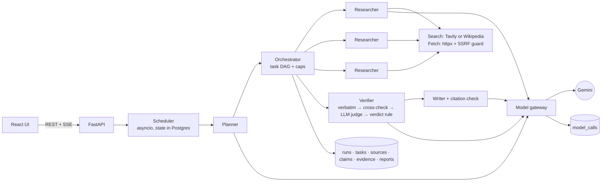

# Deep Research Agent

**Ask a hard question. A planner splits it into sub-questions you can edit, parallel researcher agents
search and read the web, a verifier checks every claim against the exact quotes behind it, and a writer
produces a report in which every sentence links to its evidence.**

For anyone who needs a cited answer they can audit, not a confident paragraph. Build 04 of the
"AI Engineer Projects Roadmap": planning, agent orchestration, source verification.

- **Live link:** none yet. It runs locally end to end. Deployment steps for Render, Neon and Vercel are in [DEPLOYMENT.md](DEPLOYMENT.md) but have not been carried out.
- **Demo video:** not recorded yet.
- **Headline numbers (live, Tavily search, n=6):**
  - 47% of cited claims are "supported": verbatim quotes from 2+ independent sites, with no strong contradiction. Before the cross-check fix it was 33%.
  - 100% of cited claims are backed by at least one verbatim supporting quote.
  - About $0.001 and 14 s per report.
  - See [Evaluation](#evaluation).

## What it does

1. **Ask** a question with a depth (quick, standard or deep), a token budget and a number of parallel researchers.
2. **Review the plan.** The planner returns JSON (a brief plus sub-questions with `depends_on`). You can
   edit, add or remove sub-questions and rewire dependencies; cycles are rejected. Nothing is searched until you approve.
3. **Watch it work.** Server-sent events stream each search, page read, claim extracted and claim checked. Independent sub-questions run at the same time.
4. **Read the report.** Every sentence carries numbered claim chips coloured by verdict. Disputed claims appear in their own section. Single-source claims are hedged.
5. **Audit a claim.** Each quote is shown with its stance (supports, contradicts or not enough) and confidence, highlighted in the stored page text, with the source's domain, publish and fetch dates, and content hash.

## Architecture



| Layer | Choice |
|---|---|
| API | FastAPI, Pydantic v2, SSE progress tailing a `run_events` table |
| Orchestration | plain asyncio: a DAG of tasks with caps on workers, steps, attempts, tokens and wall time; resumes after a crash |
| Model | Gemini (`gemini-3.5-flash-lite`, falling back to `gemini-3.1-flash-lite`) through one gateway that logs every call |
| Search / fetch | Tavily when `TAVILY_API_KEY` is set, otherwise the Wikipedia REST API; `httpx` plus a readability-style extractor |
| Data | PostgreSQL 16, SQLAlchemy 2, Alembic |
| UI | React 19, Vite, TypeScript, Tailwind v4, TanStack Query, React Router |

The verdict rule (a design choice, as in the roadmap): **supported** = verbatim quotes from 2 or more
independent origins and no strong contradiction; **disputed** = a strong contradiction; otherwise
**unverified**. Sources that share a domain, a content hash or a near-duplicate fingerprint count as one
origin, so ten copies of one press release count once.

Full walkthrough with file paths: [WORKFLOW.md](WORKFLOW.md). Design questions answered from the code: [INTERVIEW_QUESTIONS.md](INTERVIEW_QUESTIONS.md).

## Evaluation

Rule from the roadmap: no eval, not done. Mocked tests and live-model runs are kept strictly apart below.

### Live: real Gemini plus real search

All live runs were on 2026-10-31 with `gemini-3.5-flash-lite`, quick depth (the planner made 1–2
sub-questions, with 2 sources each) and 3 workers. The free Gemini quota is shared with another project,
so only part of the 22-question set has run. The runner is resumable, so the rest can follow. Raw records,
including every quote, verdict and model call, are in `evaluation/runs/<name>/`.

| Metric | Wikipedia search<br/>n=10 | Tavily search<br/>n=6 | Tavily + cross-check v2<br/>same 6 runs |
|---|---|---|---|
| Answer accuracy (accepted answer string in the report) | 9 / 10 | 6 / 6 | 6 / 6 |
| Required-fact recall (mean) | 0.85 | 1.00 | 1.00 |
| Cited claims with a verbatim quote judged "supports" | 87.5% (14/16) | 93% (14/15) | **100%** (15/15) |
| Cited claims rated **supported** (2+ independent sites) | **0%** (0/16) | 33% (5/15) | **47%** (7/15) |
| Researcher quotes found verbatim in the stored page | 100% | 100% | 100% |
| Independent sites per report (median) | 1 | 3 | 3 |
| Model calls per report (mean) | 4.9 | 5.0 | (+1 verify call) |
| Tokens per report (mean) | 6,487 | 7,441 | — |
| Cost per report (mean) | $0.0008 | **$0.0011** | — |
| Wall time per report | p50 10.5 s, max 32.1 s | **p50 14.3 s**, max 31.5 s | — |

Results files: `evaluation/results/live-wiki-quick.json`, `live-tavily-quick.json` and `live-tavily-quick-reverified.json`.

**What changed between columns:**

- **Wikipedia → Tavily** changes the search provider. Every Wikipedia page counts as one origin, so nothing
  could reach "supported" under the two-origin rule.
- **Cross-check v2** (`backend/app/research/verifier.py: best_sentence`) is the most important measured change.
  - *The problem:* the cross-check looks in other stored pages for a sentence that confirms or contradicts a claim. It required 60% word overlap with the claim. Real sites word facts differently ("architectural height … 828 meters (2,717 feet)" vs "828 m (2,717 ft) tall"), so it missed them.
  - *v2:* it also accepts a sentence that repeats one of the claim's numbers and shares at least 30% of its words. Units ("meters"/"m") and number formats ("2,717"/"2717") are normalised.
  - *How it was measured:* `evaluation/reverify.py` re-ran **only the verifier** on the six stored runs. The research, pages and report were identical; only verdicts could change.
  - *Result:* 4 claims moved from unverified to supported, and none moved the other way. I read all 4 by hand: each is backed by real quotes from 2–3 independent sites.

**Cost:** tokens × configured list price ($0.10 / $0.40 per 1M input/output tokens). The free tier billed $0, so check current Gemini pricing before quoting a dollar figure. The re-verify column has no cost or time row because it re-ran the verifier only.

**Caveats:**

- Answer and fact checks are deterministic string matches. They are cheap and reproducible, but a correct paraphrase can be scored as wrong, so treat accuracy as a lower bound.
- With n=6–10 these numbers are indicative, not benchmarks.
- "Independent" means different sites. It does not judge source quality: an instagram.com page counted as one origin in q12.

**Live call log:** 100 Gemini calls in total; 95 succeeded and 5 errored.

| Errors | What happened |
|---|---|
| 2 writer 400s | before the schema fix |
| 2 rate limits | retried successfully |
| 1 failed call | an eval-script event-loop bug, now fixed (see below) |

Per-stage p50 latency: plan 1.7 s, research 1.8 s, verify 1.3 s, write 1.2 s.

### Live: verifier on labelled claim–quote pairs (`evaluation/results/verifier-live.json`)

24 hand-written pairs, 8 each of supports, contradicts and insufficient, including one prompt-injection quote,
judged in one batched call: **24 / 24 correct, 0 false "supports"**. The set is small and easy. It shows the
judge behaves sensibly; it does not show robustness.

### Parallel workers

| Setting | 1 worker | 2 workers | 4 workers |
|---|---|---|---|
| **Simulated**: 4 independent sub-questions, real orchestrator, stage latencies injected at the live p50s | 16.6 s | 10.4 s | 7.4 s (2.2×) |

Live, at quick depth (the planner made 1–2 sub-questions): q20 took 14.2 s with 1 worker and 8.8 s with 3, while
q07 took 8.9 s and 9.4 s. With n=2 and so little to parallelise, the live comparison is **inconclusive**. The
simulated benchmark is where the speedup is measured; it does not measure Gemini or the web.

### Mocked test suites (no network, no quota)

| Suite | Result |
|---|---|
| `pytest` (unit + orchestration + API), SQLite | **43 passed** |
| same suites on PostgreSQL 16 | **43 passed** |
| Vitest (frontend) | **6 passed** |
| `ruff` (F, E9, B), `tsc`, `oxlint`, `vite build` | clean |

These cover the claims the roadmap's milestones make:
- **M4:** a planted false claim with a fabricated quote ends up unverified.
- **M5:** a sentence citing a made-up claim id is dropped.
- **Durability and caps:** budget stop, retries, cancel that keeps partial results, resume after a crash.

## Run it locally (three commands, plus keys)

Prerequisites: Docker, Python 3.12+ (developed on 3.14), Node 20+ (developed on 24).

```bash
cp backend/.env.example backend/.env   # then set GEMINI_API_KEY (and TAVILY_API_KEY for multi-domain search)
docker compose up -d db && cd backend && python -m venv .venv && .venv/Scripts/pip install -r requirements-dev.txt && .venv/Scripts/python -m alembic upgrade head
.venv/Scripts/python -m uvicorn app.main:app --port 8020   # in another terminal: cd frontend && npm install && npm run dev
```

(On macOS and Linux use `.venv/bin/`.) Open http://localhost:5183. To click through a finished report
without any key or network, seed the offline demo: `cd backend && .venv/Scripts/python -m scripts.seed_demo`
(scripted content, labelled "[offline demo]", and excluded from the cost dashboard).

Ports: API 8020, web 5183, PostgreSQL 5436 (Compose project `deep-research-agent`).

Tests and evaluation:

```bash
cd backend && .venv/Scripts/python -m pytest
```

```bash
cd frontend && npm test
```

```bash
backend/.venv/Scripts/python evaluation/run_eval.py --name live-wiki-quick --ids q03,q04 --depth quick
```

```bash
backend/.venv/Scripts/python evaluation/eval_verifier.py --name verifier-live
```

```bash
backend/.venv/Scripts/python evaluation/bench_parallel.py
```

## Decisions and trade-offs

- **Plain asyncio, not LangGraph or a queue.** The control flow is a small DAG loop, and keeping it in my
  own code keeps it explainable. Durability comes from Postgres rows plus resume-on-boot. The cost is that
  only one API instance can run; scaling out needs lease-based claiming.
- **Number-aware cross-check.** Matching on shared words alone was too literal for real pages. Requiring a shared number, plus a smaller word overlap, raised "supported" from 33% to 47% on identical research. The LLM judge still decides what each sentence says.
- **Verbatim quotes before any LLM judging.** It is cheap, it cannot be argued with, and it catches a
  fabricated quote without spending tokens. The LLM judge only sees quotes that really exist.
- **A strict two-origin rule.** It makes the "supported" share honest but harsh with a single-publisher
  search provider: Wikipedia alone gave 0%. The fix was better search (Tavily, 33%) and better matching (47%), not a looser rule.
- **The writer sees claims, not pages, and a deterministic citation check runs last.** A sentence with no
  real claim behind it is dropped, not trusted.
- **One gateway.** It caught a real provider quirk: Gemini rejected the writer's schema because of its nested
  size limits. Now the provider gets a flat schema and Pydantic enforces the limits.

What failed, and what I measured from it:
- Wikipedia returned 403 to an anonymous User-Agent, and the run was wrongly marked "completed". Now such runs fail with `research_failed`, and the User-Agent is configurable.
- Two parallel researchers storing the same URL raced on a unique constraint (caught by an intermittent test). Fixed.
- Wikipedia search sometimes returned the wrong entity (a Liverpool "Shanghai Tower" proposal), and quick depth has no follow-up search to recover. Tavily found the right one.
- The eval scripts reused the Gemini async client across separate event loops, and the second batch failed with "Event loop is closed". Each batch now runs in one loop. The API was never affected: its scheduler keeps a single loop.

Next, with more time:
1. Run the remaining 16 questions with Tavily, and compare quick against standard depth (3 sources per sub-question gives the two-origin rule more to work with).
2. Answer grading that tolerates paraphrase.
3. Recency weighting using the stored publish dates.
4. Lease-based multi-instance workers.
5. A harder verifier set built from real disagreements.
6. Source-quality weighting (e.g. a social-media post should not count the same as an official site).

## Repository

```
backend/app/llm/          gateway, provider adapter, versioned prompts, output schemas
backend/app/research/     planning, orchestrator, researcher, web, verifier, writer, scheduler, simulated
backend/app/api/          routes (REST + SSE), schemas, errors, rate limit
backend/migrations/       Alembic (0001 initial schema)
backend/tests/            unit, orchestration and API tests
evaluation/               labelled questions, verifier pairs, runners, raw runs, results
frontend/src/             pages, components, API client, SSE hook, tests
```
