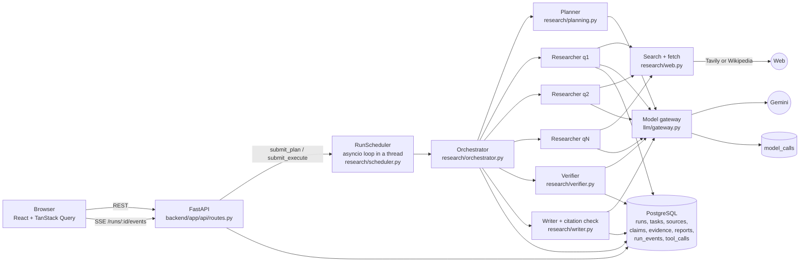
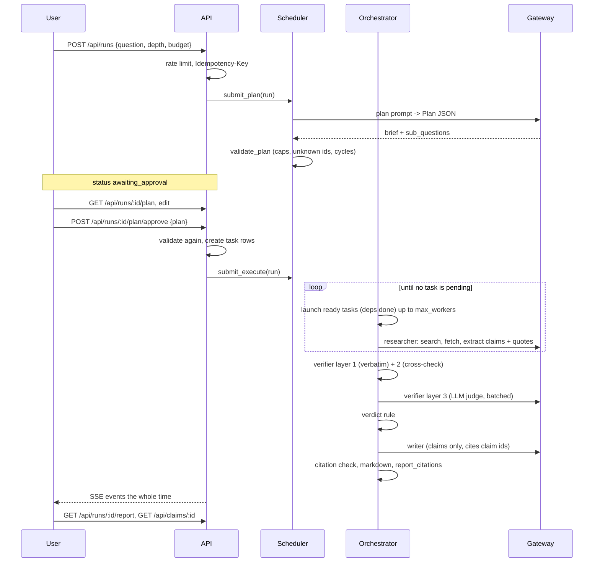
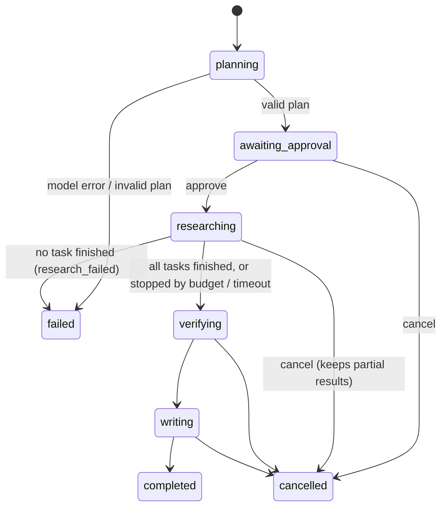
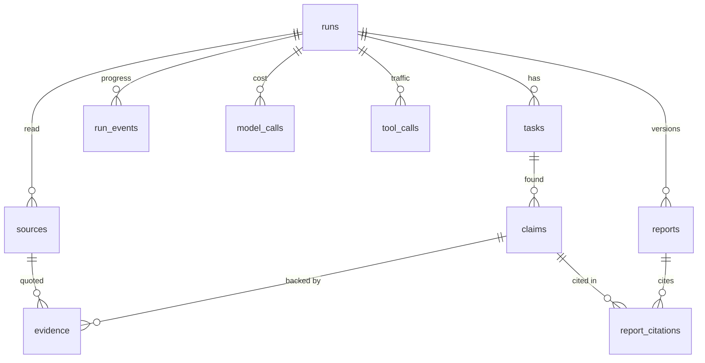

# How it works

This page describes the code as it is, file by file. Paths are relative to the repository root.

## 1. Architecture

| Layer | Choice | Where |
|---|---|---|
| API | FastAPI, Pydantic v2, one error envelope | `backend/app/main.py`, `backend/app/api/` |
| Jobs | in-process asyncio loop; state in Postgres rows | `backend/app/research/scheduler.py` |
| Agents | plain async Python, no framework | `backend/app/research/` |
| Model | Gemini through one gateway, with an ordered model fallback | `backend/app/llm/` |
| Search | Tavily if `TAVILY_API_KEY` is set, else the Wikipedia REST API | `backend/app/research/web.py`, `env.py` |
| Fetch | `httpx` + a BeautifulSoup readability-style extractor | `backend/app/research/web.py` |
| Database | PostgreSQL 16 (SQLAlchemy 2, Alembic) | `backend/app/models.py`, `backend/migrations/` |
| UI | React 19, Vite, Tailwind v4, React Router, TanStack Query | `frontend/src/` |

## 2. A run, end to end

### Run states (`runs.status`)

Task states (`tasks.status`): `pending → running → done`. A failure that can be retried goes back to
`pending` (up to `MAX_TASK_ATTEMPTS`). Otherwise the task becomes `failed`. Tasks whose dependencies
failed, or that were never started because of the budget or the clock, become `skipped`.

## 3. The stages in detail

### Planner: `backend/app/research/planning.py`
- `plan_prompt()` builds the versioned prompt (`plan-v1` in `llm/prompts.py`). The model must return the
  `Plan` schema (`llm/schemas.py`): `brief`, `sub_questions[{id, ask, why, depends_on}]`, `report{max_words, must_cite}`.
- `validate_plan()` enforces the depth's sub-question cap, unique ids and known dependencies, and runs
  Kahn's algorithm to reject cycles. The same function validates the user's edited plan on approve. The UI
  repeats these checks (`frontend/src/lib/format.ts → planProblems`) so it can explain a problem before submitting.
- `depth_profile()` maps quick, standard and deep to caps on sub-questions, sources per task, steps per agent and report words.

### Orchestrator: `backend/app/research/orchestrator.py`
- `_research_phase()` is the DAG loop. Each tick it reads the task rows, skips tasks whose dependencies
  failed, and launches every ready task while `len(running) < max_workers`. It then waits for the first to
  finish, or 0.5 s, so a cancel flag in the database is noticed quickly.
- Caps: the run **timeout** (`RUN_TIMEOUT_SECONDS`) cancels running workers. The **budget** check
  (`research_budget_share`, default 70%) stops new research so verify and write still fit in the remaining budget.
  **Steps per agent** and **attempts per task** are bounded.
- **Resume:** on entry, tasks left `running` by a crashed process go back to `pending`. `done` tasks
  are never re-run (`tests/test_pipeline.py::test_resume_after_crash_reruns_only_unfinished_tasks`).
- **Shutdown vs cancel:** a deploy or a sleeping instance sends SIGTERM, and `RunScheduler.stop()` cancels
  in-flight jobs and waits for them. Without `cancel_requested` set, this is treated as a shutdown:
  interrupted tasks go back to `pending`, the run keeps its status, and the next boot resumes it.
- **Cancel:** `POST /runs/:id/cancel` sets `cancel_requested` and cancels the asyncio task.
  `finish_cancelled()` then runs the verifier's deterministic layer only and writes a no-model report, so
  partial results remain readable.
- If no task finished, the run fails with `research_failed`, and if no claim was extracted it fails with
  `no_claims`, instead of "completing" with an empty report. Live runs hit both: Wikipedia returned 403,
  and a Tavily search returned only generic pages.

### Researcher: `backend/app/research/researcher.py`
The loop for one sub-question, up to `max_steps`:
1. `_search()` calls the search provider and logs a `tool_calls` row.
2. `_read()` fetches the top new URLs in parallel (`web.HttpFetcher`): only http(s), every redirect hop
   re-checked against private, loopback, link-local and metadata addresses (SSRF guard), a size cap, HTML or
   text only. If the fetch fails, Tavily's own extracted text is used.
3. `_store_source()` saves the page once per run: URL, registrable domain, title, `published_at` (from
   meta tags, `<time>` or JSON-LD), `fetched_at`, the sha256 `content_hash`, a shingle fingerprint, the raw
   page and the extracted text. Two parallel workers often find the same URL. The unique constraint
   `(run_id, url)` picks one winner and the other reuses its row (a race that the tests caught).
4. One model call (`research-v1`) receives the sources as `<source id="S1" …>` blocks marked as
   untrusted data and returns `ResearchStep{claims[{text, quotes[{source, quote}]}], summary, next_query}`.
5. `_save_claims()` stores each claim with `Evidence` rows. `quote_found` records whether the quote really
   occurs in that stored page (`web.quote_in_text`, which ignores whitespace, case and curly quotes).
6. `next_query` is only ever sent to the search API, never fetched as a URL, so a page cannot steer the agent to a link it contains.

Dependent tasks receive their dependencies' compressed `summary`, never raw pages.

### Verifier: `backend/app/research/verifier.py`
1. **Verbatim layer:** evidence with `quote_found = false` becomes `insufficient` with no model call.
2. **Cross-check layer** (`add_cross_checks`, `best_sentence`): for each claim, the best-matching sentence
   from every other origin's stored page is added as `cross_check` evidence, up to 3 per claim.
   A sentence matches when it shares ≥ 60% of the claim's keywords, **or** when it repeats one of the
   claim's numbers and shares ≥ 30% of the keywords. Units and digit grouping are normalised first
   ("meters" → "m", "2,717" → "2717"). The number-aware rule was added after live runs showed real sites
   wording the same fact too differently. On identical research it raised supported claims from 33% to 47%
   (README, Evaluation).
3. **LLM judge** (`verify-v1`): pending pairs go out in batches of `VERIFIER_BATCH_SIZE`, in parallel,
   and each returns `supports`, `contradicts` or `insufficient` with a score.
4. **Verdict rule** (`decide_verdict`, applied per `group_key` so duplicate claims share evidence):
   - `origin_map()` unions sources that share a domain, a content hash or a shingle fingerprint. Ten
     sites republishing one press release count as one origin (citation laundering).
   - **disputed:** a verbatim quote contradicts the claim with score ≥ `STRONG_CONTRADICTION_SCORE` (0.7).
   - **supported:** verbatim supporting quotes (score ≥ 0.5) from ≥ `MIN_INDEPENDENT_DOMAINS` (2) origins.
   - **unverified:** everything else.

If the verifier's model call fails (quota, for example), `execute_run` falls back to the deterministic layers only, and the run still completes.

### Writer and citation check: `backend/app/research/writer.py`
- `_representatives()` keeps one claim per `group_key`, best supported first, with a cap of 45.
- The writer (`write-v1`) sees only claims labelled `C1…Cn` with their verdict. It must return
  `sections[{heading, sentences[{text, claim_ids}]}]`. Disputed claims go in a "Disputed or uncertain"
  section, and unverified claims must be hedged.
- `citation_check()` maps each sentence to real claims and **drops** any sentence that cites none. It
  counts invalid ids, disputed claims cited outside the disputed section, and sentences that rest only on
  unverified claims. `save_report()` writes `reports` (versioned) and `report_citations`
  (sentence → claim), and renders Markdown with numbered sources.
- `fallback_output()` builds the report without the model when the writer fails or the budget is spent.

### Model gateway: `backend/app/llm/gateway.py`
- One entry point, `ModelGateway.generate(prompt, OutputModel, ctx)`, for planner, researchers, verifier and writer.
- It sends `provider_schema()`, a flat JSON schema with `$ref`s inlined and size limits removed. Gemini
  rejected the writer's nested size limits with a bare 400 (found in a live run). The reply is still
  validated against the full Pydantic model in `parse_reply()`.
- Retries: transient errors (5xx, timeouts, rate limits) back off exponentially with jitter. Invalid JSON gets one more try.
  A **daily-quota 429** is not retried: the gateway moves to the next model in `GEMINI_MODELS`. So does a
  model whose retries all fail on transient errors (a preview model can stay overloaded for minutes).
- Spend guards, all counted from `model_calls`:
  - `DAILY_CALLS_PER_MODEL`: a model at its cap for today is skipped (`allow_model`).
  - `DAILY_MODEL_CALL_LIMIT`: the whole app's daily total (`allow_call`).
  - `MAX_MODEL_CALLS_PER_RUN`: per report (`allow_run_call` → `run_call_budget`). `researcher.budget_left`
    stops research 2 calls early, so verify and write still fit.
  - `POST /api/runs` refuses new runs with `429 daily_quota_reached` when fewer than 4 calls are left today.
- Every attempt, success or error, becomes a `model_calls` row (trace id, run, task, feature, model,
  prompt version, tokens, cost, latency, status). `record_call_to_db` also increments `runs.spent_tokens`
  and `cost_usd` atomically. That is how budgets are enforced.
- Cost = input tokens × input price + (output + thinking tokens) × output price, using the list prices in config.

### API: `backend/app/api/routes.py`

| Roadmap endpoint | Here |
|---|---|
| `POST /runs` | `POST /api/runs`, returns 202 with the run. Honours `Idempotency-Key` (hashed with the pipeline version) |
| `GET /runs/:id/plan` | `GET /api/runs/{id}/plan` (409 until the plan exists) |
| `POST /runs/:id/plan/approve` | `POST /api/runs/{id}/plan/approve` with an optional edited plan |
| `SSE /runs/:id/events` | `GET /api/runs/{id}/events`, tails `run_events` and supports `Last-Event-ID` |
| `GET /runs/:id/report` | `GET /api/runs/{id}/report`: sections, stats, cited claims and their sources |
| `GET /claims/:id` | `GET /api/claims/{id}`: evidence with stance, score, source dates and hash, and page context |
| `POST /runs/:id/cancel` | `POST /api/runs/{id}/cancel` |

Also `GET /api/runs`, `GET /api/runs/{id}`, `/sources`, `/claims`, `GET /api/metrics` (the cost dashboard)
and `GET /api/health`. The middleware adds request ids, structured logs and an optional demo access code.

## 4. Data model (`backend/app/models.py`, migration `0001`)

The roadmap's tables appear as written. The changes:
- `tasks.depends_on` is JSON (JSONB on Postgres) rather than `uuid[]`, so the same models run on SQLite in unit tests.
- `evidence.quote_found` and `evidence.origin` are added.
- `sources` stores `raw_content`, `text` and `shingle_hash` alongside `content_hash`.
- `run_events` (the SSE log) and `tool_calls` (search and fetch) are added.

## 5. Frontend (`frontend/src/`)

| Screen | File | What it does |
|---|---|---|
| New research | `pages/NewResearch.tsx` | question, depth, budget, worker count, an Idempotency-Key per submission, recent runs |
| Plan review | `components/PlanEditor.tsx` | edit, add or remove sub-questions, toggle dependencies, client-side cycle check, approve |
| Live progress | `pages/RunPage.tsx` + `lib/useRunEvents.ts` | SSE events → activity log; counts, budget bar and task states refresh as events arrive |
| Report | `components/ReportView.tsx` | sentences with numbered claim chips coloured by verdict, the citation-check panel, Markdown download |
| Claim audit | `components/ClaimView.tsx`, `pages/ClaimPage.tsx` | verdict and reason, every quote with stance and score, highlighted page context, source dates and hash |
| History | `pages/Runs.tsx` | all runs with tokens, cost and time |
| Cost & quality | `pages/Metrics.tsx` | per-stage calls, tokens, cost, p50/p95 latency, errors, cited-and-supported share |

## 6. Tests and evaluation

| Suite | Command | What it covers |
|---|---|---|
| Unit | `pytest tests/test_units.py` | gateway retries, model fallback, daily limit, quota classification, cost, plan DAG checks, verdict rule, origin merging, verbatim quote check, extraction, SSRF guard, citation check, provider schema |
| Orchestration | `pytest tests/test_pipeline.py` | full run on the simulated web, a planted false claim, dependency ordering, rejected cyclic edit, budget stop, nothing-researched failure, worker retry, cancel keeps partial results, resume after a crash |
| API | `pytest tests/test_api.py` | plan → edit → approve → report → claim audit through the real scheduler thread; SSE; idempotency; validation; access code |
| Postgres | `USE_TEST_POSTGRES=1 TEST_DATABASE_URL=… pytest` | the same suites on PostgreSQL |
| Frontend | `npm test` (Vitest) | plan helpers, the plan editor (edit, remove, cycle blocking), report chips → claim audit |
| Live eval | `python evaluation/run_eval.py` | real Gemini plus real search on labelled questions; resumable; raw records saved |
| Re-verify | `python evaluation/reverify.py` | re-runs only the verifier on stored runs, to measure a verifier change on identical research |
| Verifier eval | `python evaluation/eval_verifier.py` | 24 labelled claim–quote pairs in one batched call |
| Parallel benchmark | `python evaluation/bench_parallel.py` | **simulated**: the real orchestrator with injected, measured stage latencies |

`backend/app/research/simulated.py` is the scripted model and offline web shared by the tests and the benchmark. It never measures model quality.
